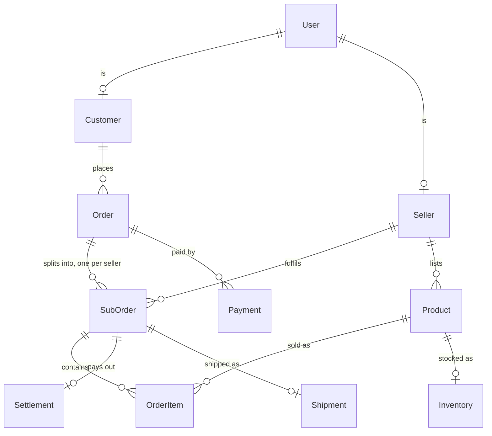
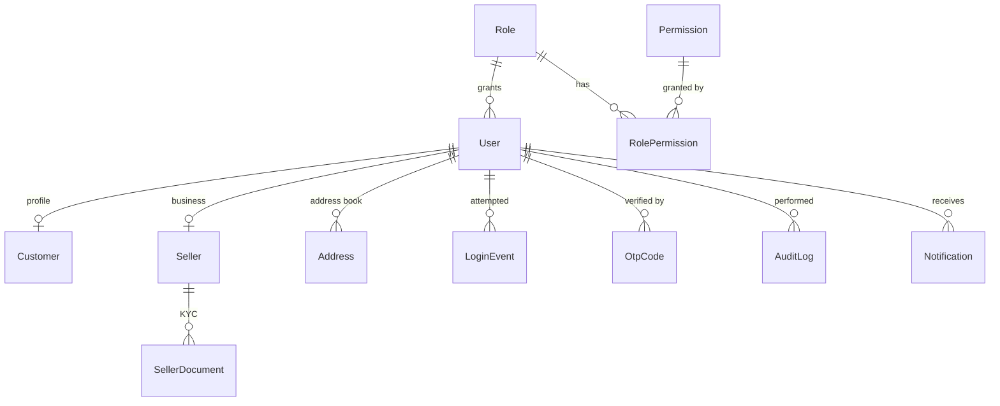
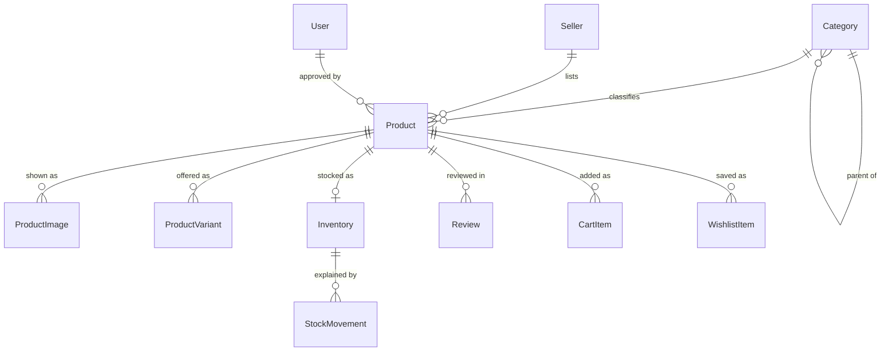
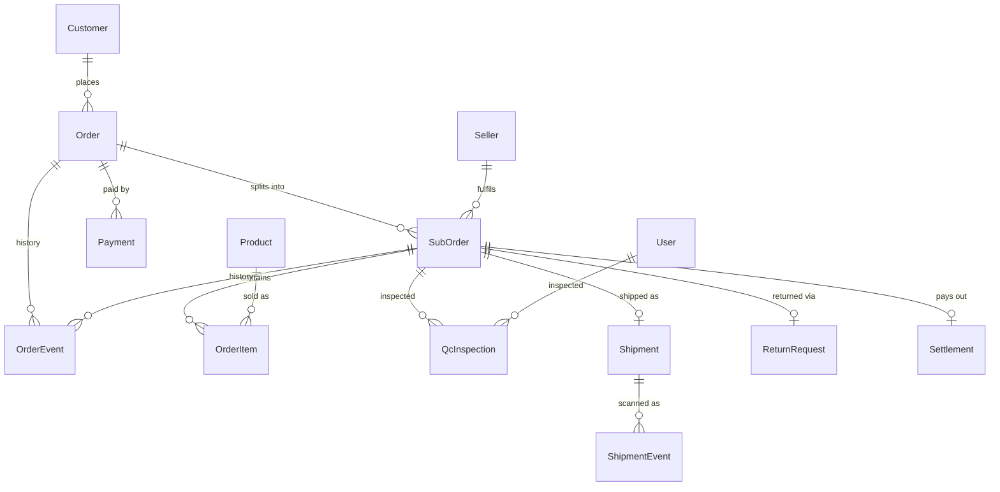
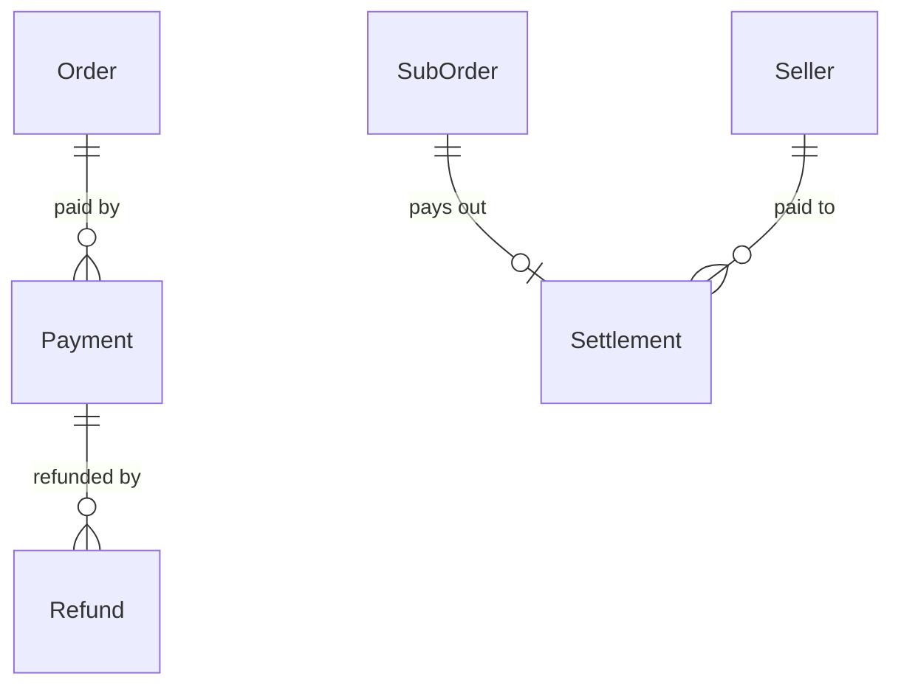
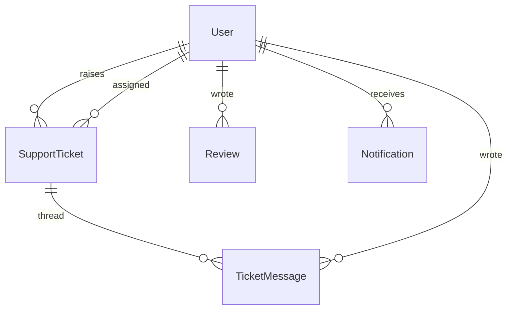

# Entity relationship diagrams

Generated from `prisma/schema.prisma` — 33 models. The rationale behind these
shapes is in **[DATA_MODEL.md](DATA_MODEL.md)**.

Diagrams are Mermaid. They render in GitHub, in VS Code with any Mermaid
extension, and at [mermaid.live](https://mermaid.live) if you would rather paste
one in. Every relationship shown below is a real foreign key in the schema; the
whole model is not drawn as one graph because 33 entities in one frame is a
picture nobody reads.

---

## 1. The spine

The relationships that matter most, with the detail tables left out. Everything
else in this document hangs off this.



**The one shape to understand:** an `Order` is what the customer places and pays
for once; a `SubOrder` is one seller's share of it, and it is the row the
warehouse picks, QC inspects, logistics ships and finance settles. A basket
spanning three sellers is one `Order`, three `SubOrder`s and one `Payment`.

---

## 2. Identity, roles and access



`RolePermission` is a **seeded projection** of `src/lib/auth/permissions.ts`,
which is what authorisation checks actually read. The admin screen renders these
rows and checks them for drift against the constants; it does not edit them.

A `User` is at most one of a `Customer` or a `Seller`. Staff accounts — admin,
finance, marketing, support, warehouse, QC, logistics — are a `User` with a role
and neither profile.

---

## 3. Catalogue and inventory



`Category` is self-referencing but deliberately **only two levels deep** — a
parent and its children. The mega-menu is built from this tree, and a third level
would have nowhere to render.

`StockMovement` is append-only: every change to `Inventory` has a row saying who
changed it and why, so any balance can be reconstructed.

---

## 4. Orders and the fulfilment pipeline



Notes that are not visible in the diagram:

- **`Order.status` is derived from its sub-orders**, never written directly.
- **`OrderEvent` attaches to either level** — `orderId` and `subOrderId` are both
  optional, because an order-level event (placed, cancelled by the customer) and a
  parcel-level one (picked, inspected, dispatched) are the same kind of record.
- **`QcInspection` is a list, not a single row.** A parcel that fails inspection
  is corrected and re-inspected, and both verdicts are kept — the second one being
  a re-inspection is derivable precisely because the first still exists.
- **A `ReturnRequest` and its `SubOrder` status are two different facts.** The
  request holds the support desk's decision; the sub-order holds where the parcel
  physically is. Approving a return does not move goods.

---

## 5. Money



Every amount is an integer number of paise. `Payment` is read-only in the
application — it records what a gateway did, and no screen can invent one.
A `Payment` becomes `REFUNDED` only when the whole of it has come back; a partial
refund leaves it `SUCCESS`, because it was.

A `Settlement` exists per **delivered** sub-order. Commission is charged on the
sub-order's gross value, before any platform-funded coupon.

---

## 6. Marketing, content and support



`Coupon`, `Banner`, `Campaign`, `CmsPage`, `NewsletterSubscriber`, `Setting` and
`AuditLog` carry **no foreign keys** and so appear in no diagram. That is not an
oversight:

- A `Coupon` is matched by code at checkout and its effect is recorded on the
  `Order`, so a relation would only duplicate what the order already stores.
- `Banner`, `Campaign` and `CmsPage` are content, addressed by slot or slug.
- `Setting` is typed key/value configuration that the checkout and storefront read
  at runtime.
- `AuditLog` references a `User` and otherwise stores the target as a
  **type plus id string**, deliberately: an audit row must survive the deletion of
  the thing it describes, which a foreign key would prevent.

A `TicketMessage` marked `isInternal` is filtered out of the customer's view **in
the query**, not in the component — the customer's thread never loads it.

---

## Regenerating

There is no generator step: these diagrams are maintained by hand alongside
`prisma/schema.prisma`. To check them against the schema, the relation list can be
printed with:

```bash
npx prisma validate && npx prisma format
```

and the model bodies read directly — every relationship above corresponds to a
`@relation` in the schema.
